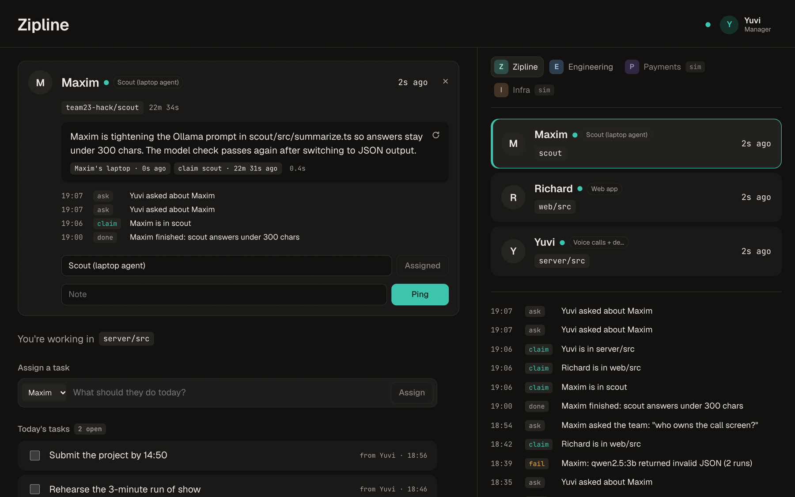
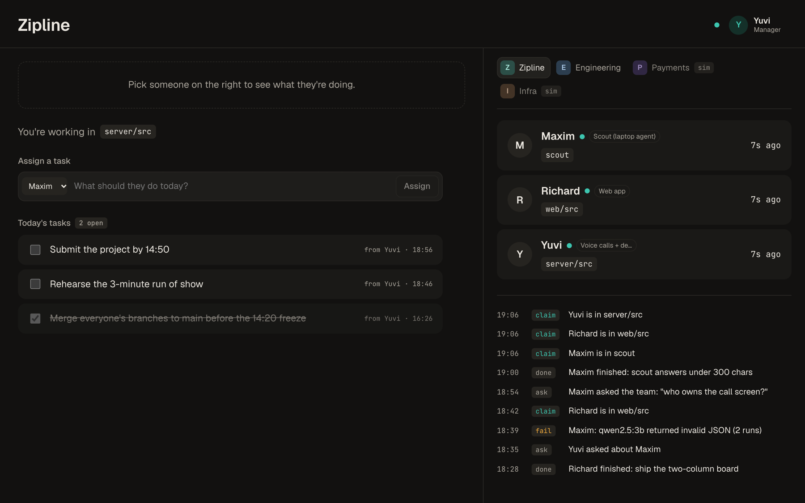
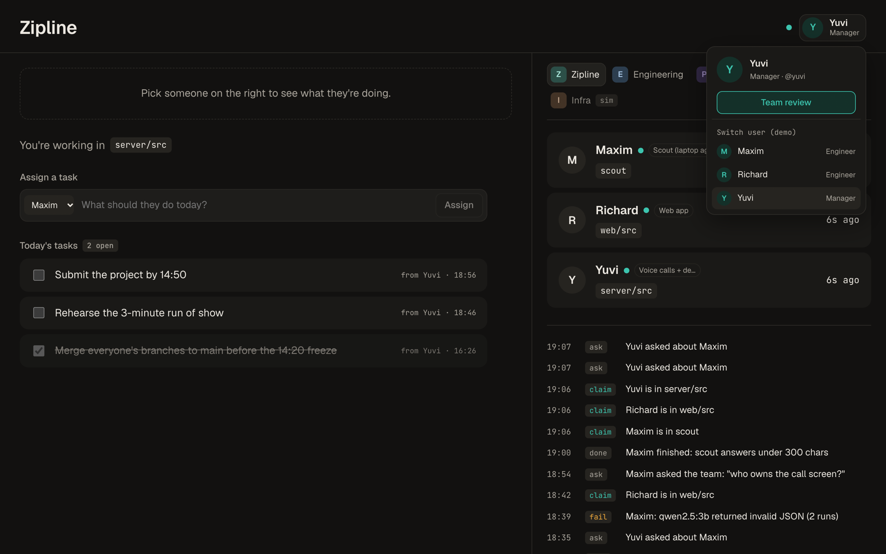
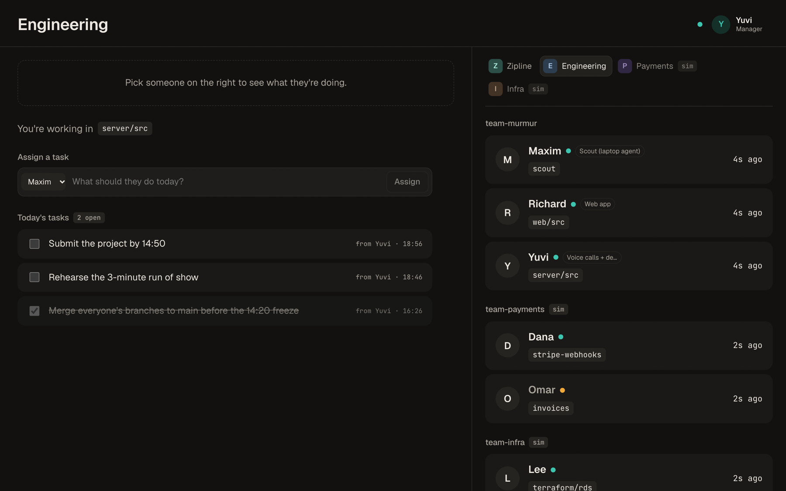
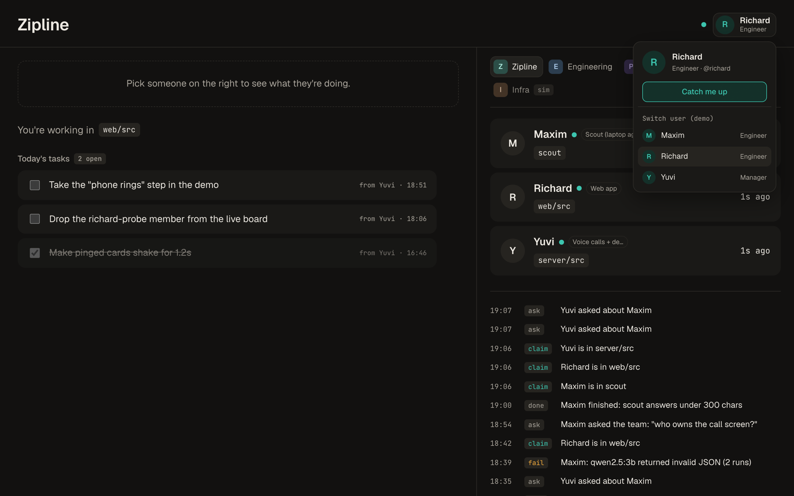
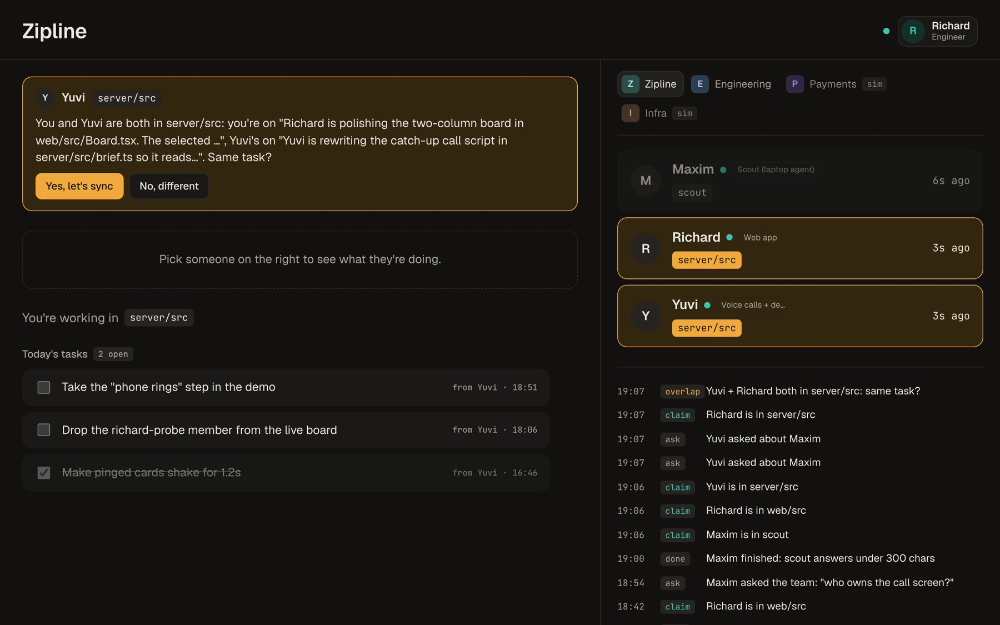
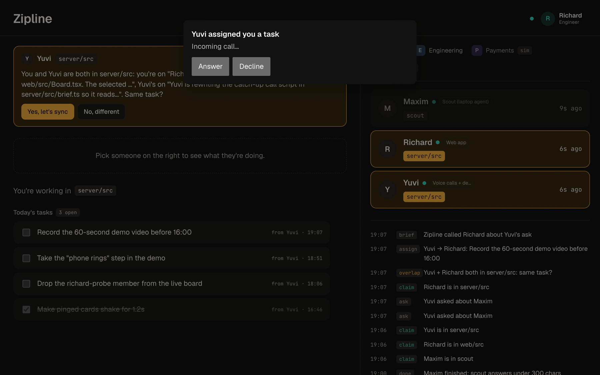
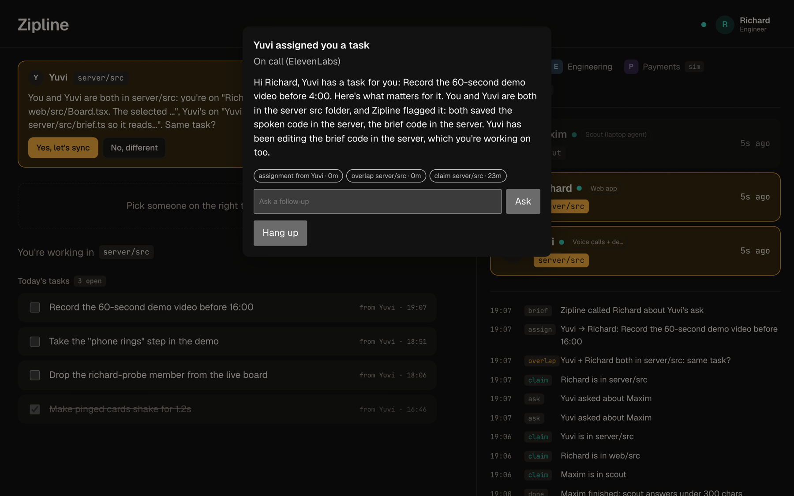
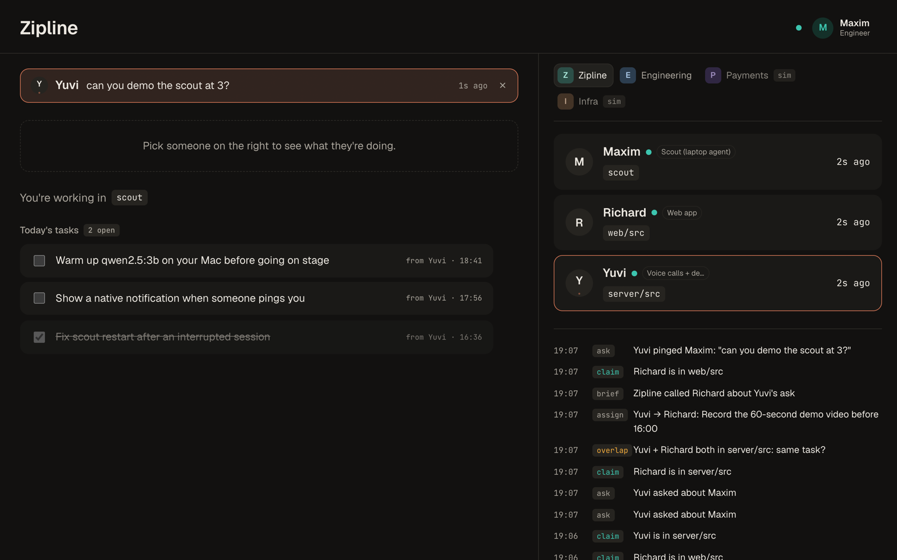
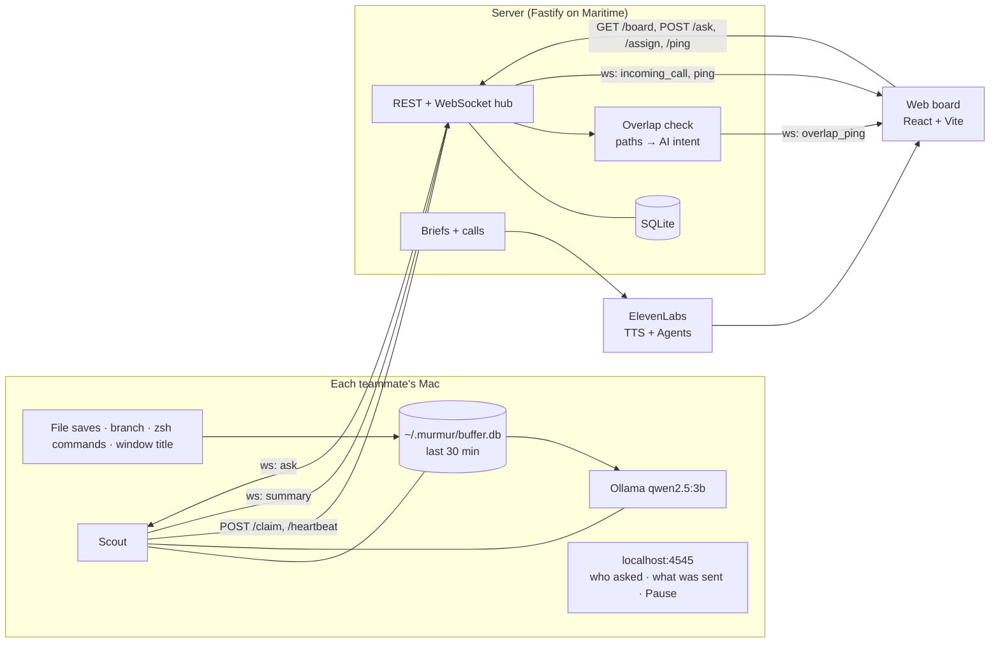

# Zipline

**Live context for small teams.** Ask what a teammate is doing and get an answer a few seconds old, written by their own laptop. Zipline catches two people starting the same task before they both finish it, and when your manager hands you something, your phone rings and an ElevenLabs voice catches you up.

Built in four hours by Team 23 at the **YC × ElevenLabs hackathon** (UWaterloo, 22 Nov 2026). The challenge was *"an AI coworker you'd actually use."*



---

## The problem

Status updates go stale quickly. Standups are a day old, Slack statuses are never updated, and "what are you working on?" interrupts the person you ask. On small teams the most expensive version of this is two people quietly building the same thing.

## What Zipline does

| | |
|---|---|
| **Ask anyone, get a live answer** | Click a teammate and Zipline asks *their laptop*. A small local model (Qwen 2.5 3B on Ollama) reads their last 30 minutes of file saves, branch, commands and window titles. It writes a ≤300-character answer with sources (files, commits, commands). Nothing is cached, so the answer is always current. |
| **"Same task?" alerts** | Each laptop claims the folder it's working in. When two claims overlap, a two-stage check runs: first file paths, then an AI intent check. Both people get a card asking whether they're on the same task, with *Yes, let's sync* / *No, different*. |
| **Voice catch-up calls** | When the manager assigns a task, the assignee's screen rings. The call reads a brief written for that listener: the task, plus anything overlapping it. ElevenLabs reads it aloud, and you can ask follow-ups mid-call. |
| **Manager team review** | The manager's *Team review* is a talk-back ElevenLabs Agent. It can query the live board through an `ask_zipline` client tool. |
| **Roll-ups** | Team boards roll up into a department view (Engineering = Zipline + Payments + Infra). One glance shows who is where across teams. |
| **Privacy by default** | Raw activity never leaves the laptop. The scout sends only a *claim* (the folder, the branch and the top 5 file paths) unless someone asks. A local page at `localhost:4545` shows who asked about you and exactly what was sent, with Pause/Resume. |

---

## Walkthrough

The web app has a demo user switcher (top-right avatar → *Switch user*), so one browser can show every role. The screenshots below use the local demo seed (see [Run it locally](#run-it-locally)).

### Manager view (Yuvi)

The manager sees the live team on the right and the activity feed below it. The left column holds the selected person, an **Assign a task** form and today's tasks.



Clicking a teammate asks their laptop directly. The answer below came from Maxim's scout in 0.4s. It cites the claim it's based on, how fresh it is and which laptop wrote it. From the same card the manager can set the person's project or send a ping with a note.


The profile menu has **Team review**, a voice call with an ElevenLabs agent that briefs the manager on the whole team and answers questions about it.



### Department roll-up

The **Engineering** tab stacks every team's board. Payments and Infra are simulated teams that show how boards roll up from team to department to company.



### Engineer view (Richard)

Engineers get **Catch me up** instead of Team review: a short call about what changed on the team since they last looked.



#### "Same task?"

Richard opens `server/src`, the folder Yuvi is already working in. Both cards turn amber and Richard gets a card quoting what each of them is doing, so he can sync before they duplicate work.



#### The phone rings

Yuvi assigns Richard a task, and Richard's screen rings.



When he answers, the brief is spoken in an ElevenLabs voice. It covers the task and what matters for it, including the overlap Zipline just flagged. Each claim is shown as a source chip, and Richard can ask a follow-up without hanging up.



### Pings (Maxim)

A ping is a lightweight nudge with a note. It lands at the top of the recipient's board and the sender's card lights up.



---

## How it works



1. **Scout** (`scout/`) runs on each laptop. It watches the checkouts in `WATCH_REPOS` with chokidar, captures shell commands through a zsh hook, reads the frontmost window title with `osascript`, and keeps a 30-minute buffer in SQLite. On its own it sends only a **claim** (`POST /claim`) and a heartbeat every 15s.
2. **Ask.** When someone opens your card, the server forwards the question over your scout's WebSocket. Your local model writes the answer and sends it back. Questions to the whole team or department are answered on the server (Claude Haiku, or any OpenAI-compatible / Ollama endpoint via `LLM_URL`).
3. **Overlap.** Every claim is checked against the others: by path and file first, then by an AI verdict on intent. A match pushes `overlap_ping` to both people. The answers go to `POST /overlap/:id/answer`.
4. **Calls.** `POST /assign` creates a task and a listener-specific brief, and pushes `incoming_call`. The web plays `GET /brief/:id/audio`: ElevenLabs `eleven_flash_v2_5`, or the browser's speech synthesis if no key is set. The manager's review uses an ElevenLabs Conversational AI agent through a signed URL (`GET /brief/:id/agent-session`).

### Repo layout

| Path | What |
|---|---|
| [`scout/`](scout) | Laptop agent: Node + TypeScript, chokidar, ws, `node:sqlite`, Ollama, zsh hook, sharing page on :4545 |
| [`server/`](server) | Fastify 5 + `@fastify/websocket`, `node:sqlite`, overlap check, briefs, ElevenLabs. Serves `web/dist` when present |
| [`web/`](web) | React 18 + Vite board, `@elevenlabs/react` for the talk-back call |
| [`shared/`](shared) | Contracts (`types.ts`), team roster (`team.json`), offline fixtures |
| [`demo/`](demo) | Seed script and curl recipes for the demo |
| [`SPEC.md`](SPEC.md) | The hackathon spec: architecture, contracts, roles, timeline |

---

## Run it locally

Requires **Node 22.5+** (for `node:sqlite`). The scout also needs [Ollama](https://ollama.com).

```bash
cp .env.example .env
```

Fill in what you have. Everything is optional for a local demo:

| Variable | Used by | Purpose |
|---|---|---|
| `SERVER_URL` | scout, web | Where the server lives (default `http://localhost:8787`) |
| `MURMUR_USER`, `MURMUR_TEAM`, `WATCH_REPOS` | scout | Who you are, your team, which checkouts to watch |
| `OLLAMA_URL`, `OLLAMA_MODEL` | scout | Local model (default `qwen2.5:3b`) |
| `ANTHROPIC_API_KEY` or `LLM_URL` / `LLM_MODEL` | server | Team/dept answers and overlap verdicts |
| `ELEVENLABS_API_KEY`, `ELEVENLABS_VOICE_ID`, `ELEVENLABS_AGENT_ID` | server | Call voice and the manager review agent |
| `DEMO_FAST_CLAIM=1` | scout | Claim on the first save instead of after 15s |

**Server** (port 8787):

```bash
cd server && npm install && npm run dev
```

**Web board** (port 5173, proxies API calls to `SERVER_URL`):

```bash
cd web && npm install && npm run dev
```

Open the manager view directly with `VITE_MURMUR_USER=yuvi`, or use the avatar menu → *Switch user*.

**Scout** (on each Mac):

```bash
bash scout/start-mac.sh <your-user> [path/to/checkout]
```

**Demo data.** On an empty database the server seeds the simulated Payments and Infra teams and some tasks. To fill the main team board without live scouts:

```bash
SERVER_URL=http://localhost:8787 sh demo/seed-team.sh
```

More curl recipes (assign → ring, briefs, audio, the agent session) are in [`demo/README.md`](demo/README.md).

---

## Built with

- **[ElevenLabs](https://elevenlabs.io)**: text-to-speech for catch-up calls and a Conversational AI agent for the manager's talk-back team review
- **[Ollama](https://ollama.com) + Qwen 2.5 3B**: on-device answers, so raw activity never leaves the laptop
- **[Anthropic Claude](https://www.anthropic.com)** (Haiku): team-wide answers and overlap intent checks on the server
- **Maritime**: hosts the server
- Fastify, React, Vite, SQLite (`node:sqlite`), chokidar

## Team 23

- **Maxim**: scout (laptop agent), context capture, local model
- **Anshi**: server: Fastify + SQLite + WebSocket hub, two-stage overlap check, Maritime deploy
- **Richard**: web board
- **Yuvi**: lead, manager view, voice catch-up calls, demo
